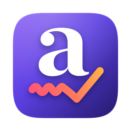

<p align="center">
  
</p>

<h1 align="center">Local Grammar</h1>

<p align="center">
  <a href="../../releases/latest"></a>
  
  
  <a href="LICENSE"></a>
</p>

Spelling and grammar underlines in every app, autocorrect as you type, and **⌥⌘G** to proofread any selection with an AI model — **all on your Mac**.

A free, open-source, fully local take on writing assistants like [Grammarly](https://www.grammarly.com). No cloud, no account, nothing you type leaves your machine.

## Features

- **Underlines everywhere** — spelling (macOS) and grammar ([Harper](https://github.com/Automattic/harper)) in native apps and in Chromium/Electron apps like Slack, Discord, Linear, Notion and your browser. Hover or click an underline to fix it, or fix all spelling at once.
- **Autocorrect in every app** — obvious typos are fixed as you type. Press **Delete** right after a correction to undo it, and that word is never corrected again.
- **⌥⌘G proofreading** — select text anywhere, press ⌥⌘G, review the changes word by word, then replace. Markdown, bullet lists, bold, code and links stay exactly as they were, and formatted text pastes back formatted.
- **Choose your AI engine:**
  - **Apple Intelligence** — Apple's on-device model, built into macOS 26. Nothing to download, and macOS manages its memory.
  - **Qwen (MLX)** — Qwen3.5 2B by default, run with Apple's [MLX](https://github.com/ml-explore/mlx). Works on macOS 14+, takes longer selections, and you can add **any MLX model from a Hugging Face link** — the app checks it fits your disk and memory, downloads it (shrinking it to 4-bit if needed) and tests it.
- **Tune each model** — creativity, time limit, longest selection, custom instructions.
- **Lives in the menu bar** — launch at login, turn checking off per app, English dialect (US, UK, Indian, …).

## Install

1. Download the latest **LocalGrammar-x.y.z.dmg** from [Releases](../../releases/latest).
2. Open it and drag **Local Grammar** into **Applications**.
3. Open Local Grammar. Because it isn't notarized by Apple, macOS blocks the first launch — go to **System Settings → Privacy & Security** and click **Open Anyway**.
   Or from Terminal: `xattr -dr com.apple.quarantine "/Applications/Local Grammar.app"`
4. Allow **Accessibility** (needed to read the text you're typing and to apply fixes).
5. In the window, pick **Apple Intelligence** or **Qwen** under *AI proofreading*.

Requires an **Apple Silicon** Mac on **macOS 14 Sonoma or later**. Apple Intelligence needs **macOS 26** with Apple Intelligence turned on.

## Apple Intelligence or Qwen?

Both fixed all 6 test sentences in [`engine/benchmark.py`](engine/benchmark.py) on an M2 MacBook Air (16 GB):

| | Apple Intelligence | Qwen3.5 2B (MLX) |
|---|---|---|
| Fixes | 6/6 | 6/6 |
| Average time | ~0.55 s | ~0.55 s |
| Download | none | ~400 MB once (Python + MLX), then 1.6 GB model |
| Memory | managed by macOS | ~1.3–1.5 GB while loaded (unload any time) |
| Longest selection | ~6,000 characters | 8,000 by default (adjustable) |
| Needs | macOS 26 + Apple Intelligence | macOS 14+ |

Apple's model occasionally declines text on sensitive topics or rephrases short forms; if it declines or the text is too long and Qwen is set up, ⌥⌘G falls back to Qwen automatically. Underlines and autocorrect don't use either model.

### Setting up Qwen

Choosing **Qwen** shows **Set Up Qwen**. The app carries the engine's scripts and [uv](https://github.com/astral-sh/uv), which installs Python and MLX into `~/Library/Application Support/LocalGrammar/engine` (about 400 MB, once). The model downloads the first time you use it, into the Hugging Face cache (`~/.cache/huggingface`).

## Privacy

Everything runs locally. The only network use is downloading Python/MLX and models from PyPI and Hugging Face when you set up Qwen or add a model. Logs (`~/Library/Logs/LocalGrammar`) record app names and outcomes, never your text. Password fields are never read.

## Troubleshooting

| Problem | Fix |
|---|---|
| No underlines anywhere | Accessibility is off or stale: in **Privacy & Security → Accessibility**, remove Local Grammar with **−** and add it again with **+**. |
| No underlines in one app | Open the menu bar icon — it says what's happening in the app in front (turned off, unreadable, too long…). Chromium apps sometimes need **Reconnect**. |
| "Apple Intelligence isn't available" | Turn it on in **System Settings → Apple Intelligence & Siri**, and wait for the model to finish downloading. |
| Qwen setup failed | **Open Log** in the setup card shows uv's output. Check your connection and press **Try Again**. |

## Build from source

```bash
git clone https://github.com/Samir-Giripunje/local-grammar.git
cd local-grammar
brew install uv        # bundled into the app to set up Qwen
./build.sh             # builds and installs /Applications/Local Grammar.app
```

Requires Xcode 26 (for Apple Intelligence) and Rust (`cargo`, for the Harper grammar checker). To package a DMG: `brew install create-dmg`, then `./build.sh --no-install && VERSION=0.1.0 scripts/make_dmg.sh`.

| Folder | What's in it |
|---|---|
| `app/` | The Swift menu bar app (SwiftUI + Accessibility) |
| `engine/` | The Qwen engine: MLX model server, model tools and benchmark (Python, uv) |
| `harper-lint/` | A small Rust wrapper around Harper for live grammar checks |
| `scripts/` | Icon, DMG background and DMG packaging |

Benchmark a model with the Qwen engine: `cd engine && uv run python benchmark.py mlx-community/Qwen3.5-2B-4bit`

## Releasing

Push a tag; GitHub Actions builds, packages the DMG and publishes the release.

```bash
git tag v0.1.1 && git push origin v0.1.1
```

To keep macOS permissions across updates, add a code-signing certificate as the `SIGNING_CERTIFICATE_P12` (base64) and `SIGNING_CERTIFICATE_PASSWORD` repository secrets; otherwise releases are ad-hoc signed and macOS asks for Accessibility again after each update.

## Credits

- **[Grammarly](https://www.grammarly.com)** — the writing-assistant experience that inspired Local Grammar. Local Grammar is an independent project and is not affiliated with or endorsed by Grammarly.
- **[Harper](https://github.com/Automattic/harper)** by Automattic (Apache-2.0) — fast, offline grammar checking.
- **[MLX](https://github.com/ml-explore/mlx)** and **[mlx-lm](https://github.com/ml-explore/mlx-lm)** by Apple (MIT) — running models on Apple Silicon.
- **[Qwen](https://huggingface.co/Qwen)** by Alibaba (Apache-2.0) — the default proofreading model.
- **[Foundation Models](https://developer.apple.com/documentation/foundationmodels)** by Apple — the on-device Apple Intelligence model.
- **[uv](https://github.com/astral-sh/uv)** by Astral (MIT/Apache-2.0) — installs the Qwen engine.

## License

[MIT](LICENSE)
